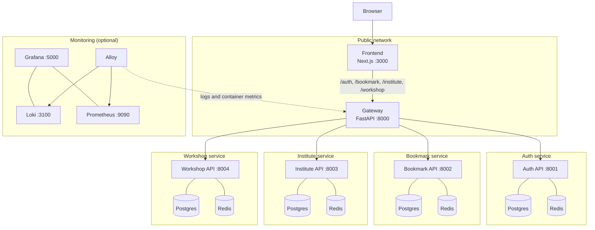

# Art Shop

Platform for discovering and creating art workshops. It provides geolocation-based
search, user registration/login with JWT sessions, per-service HTTP caching, and a
server-rendered frontend.

## Architecture



The gateway routes requests by their first path segment (`/auth/*`, `/bookmark/*`,
`/institute/*`, `/workshop/*`). It validates JWTs against the Auth service and
forwards user identity to downstream services via `X-User-Id`, `X-User-Role`, and
`X-Institute-Id` headers. Each backend owns its own Postgres database and Redis
instance on an isolated network.

| Service   | Local port | Description                          |
| --------- | ---------- | ------------------------------------ |
| Frontend  | 3000       | Next.js UI (SSR)                     |
| Gateway   | 8000       | Public API entry point / router      |
| Auth      | 8001       | Registration, login, JWT, profiles   |
| Bookmark  | 8002       | User bookmarks                       |
| Institute | 8003       | Art institutes                       |
| Workshop  | 8004       | Workshop search and management       |
| Grafana   | 5000       | Monitoring dashboards (optional)     |

## Prerequisites

- Docker Engine 24+ and Docker Compose v2
- `uv` (Python 3.14+) for running backend services and tests outside Docker
- Node.js 20+ and npm for running the frontend outside Docker

## Run the full stack

```bash
git clone <repository-url>
cd art-shop
docker compose up --build
```

The stack waits for each database and Redis instance, runs the `*-seed` containers
to create tables and sample data, then starts the APIs, gateway, and frontend.

Open:

- Frontend: <http://localhost:3000>
- Gateway / API: <http://localhost:8000>
- Individual API docs: <http://localhost:8001/docs> ... <http://localhost:8004/docs>

Stop the stack with `docker compose down`. Add `-v` to also delete database data.

### Optional monitoring stack

```bash
docker compose -f monitoring/docker-compose.yml up -d
```

Grafana is available at <http://localhost:5000> (anonymous admin access), with Loki
and Prometheus provisioned as data sources. Alloy collects container logs and
metrics from the Docker socket.

## Local development

Backend services read configuration from their own `.env`; Docker builds replace it
with `.docker.env`. Start a service's database and Redis, then run it with `uv`:

```bash
# Example: Auth service
SERVICE_NAME=auth docker compose -f auth/docker-compose.yaml up -d db redis
cd auth
uv sync
uv run fastapi dev app/main.py --port 8001
```

Repeat for `bookmark` (port 8002, DB port 5434), `institute` (8003, DB port 5435),
and `workshop` (8004). Run the gateway after the backends are up:

```bash
cd gateway
uv sync
uv run fastapi dev app/main.py --port 8000
```

The frontend defaults to `http://localhost:8000` for API calls:

```bash
cd frontend
npm ci
NEXT_PUBLIC_API_URL=http://localhost:8000 npm run dev
```

## Tests and checks

Backend tests use pytest and can run per service:

```bash
for service in auth bookmark gateway institute workshop; do
  (cd "$service" && uv sync && uv run pytest)
done
```

Frontend checks:

```bash
cd frontend
npm ci
npm run lint
npm run build
```

## Deployment

Production deployment targets Google Cloud Run as a single multi-container service
(`service.yaml`) plus a separately deployed frontend. Build and deploy with
`cloudbuild.yaml`, `cloudbuild.frontend.yaml`, and the GitHub Actions workflows under
`.github/workflows/`. See `deploy.md` for the full instructions.
