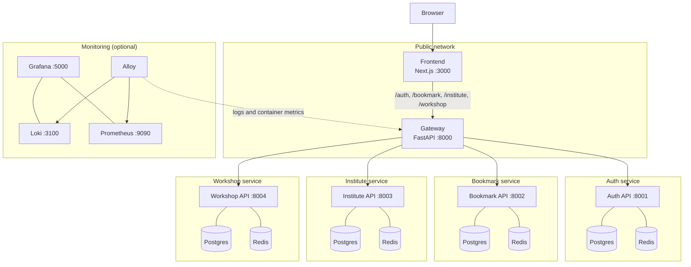

# Art Shop

Platform for discovering and creating art workshops. It provides geolocation-based
search, user registration/login with JWT sessions, per-service HTTP caching, and a
server-rendered frontend.

**Live:** [Frontend](https://frontend-204087020671.europe-west8.run.app) ·
[API gateway](https://artshop-204087020671.europe-west8.run.app)

[](https://github.com/mardisen/art-shop/actions/workflows/tests.yml)
[](https://github.com/mardisen/art-shop/actions/workflows/build.yml)
[](https://github.com/mardisen/art-shop/actions/workflows/docker.yml)
[](https://github.com/mardisen/art-shop/actions/workflows/deploy.yml)

## 1. Functionalities

- **Accounts and authentication** — registration and login, JWT access tokens,
  `Artist` and `Professor` roles, profile editing, and professor affiliation with
  an institute.
- **Workshop discovery** — full-text search, filtering by type (Drawing, Painting,
  Sculpture, Photography, Other), radius filtering from the user's browser
  geolocation (falling back to Bari), pagination, and detailed workshop pages with
  map coordinates and external links.
- **Bookmarks** — authenticated users can save, list, and remove workshops.
- **Workshop management** — professors create, edit, and delete their own
  workshops with a map picker, date, type, description, and optional link.
  Workshops are associated with the professor's institute when one is set.
- **Institute management** — professors create and edit their institute; institute
  details are publicly browsable and linked from workshop pages.
- **Performance and caching** — each backend caches read endpoints in Redis and
  invalidates cached entries on writes; the frontend uses Next.js server-side
  rendering and a single API client.
- **Observability** — optional Grafana, Loki, Prometheus, and Alloy stack for
  container logs, metrics, and dashboards.

## 2. Use cases

### Artist

1. Register or log in with the `Artist` role.
2. Browse or search workshops by text, type, and distance from the current location.
3. Open workshop details, view the associated institute, and follow external links.
4. Bookmark workshops and review them later from **Bookmarks**.
5. Update personal details and password from the profile page.

### Professor

1. Register or log in with the `Professor` role.
2. Create an institute and select it in the profile page; the institute id is then
   embedded in the JWT.
3. Create workshops under the institute with location, date, type, description, and
   website link.
4. Manage workshops from **Created Workshops** (edit or delete own workshops).
5. Browse, search, bookmark, and update the profile like any other user.


Seeded demo accounts: `artist@example.com / artist` and `prof@example.com / prof`.

## 3. Architecture



The gateway routes requests by their first path segment (`/auth/*`, `/bookmark/*`,
`/institute/*`, `/workshop/*`). It validates JWTs against the Auth service and
forwards user identity to downstream services via `X-User-Id`, `X-User-Role`, and
`X-Institute-Id` headers. Each backend owns its own Postgres database and Redis
instance on an isolated network.

| Service   | Local port | Description                          |
| --------- | ---------- | ------------------------------------ |
| Frontend  | 3000       | Next.js UI (SSR)                     |
| Gateway   | 8000       | Public API entry point / router      |
| Auth      | 8001       | Registration, login, JWT, profiles   |
| Bookmark  | 8002       | User bookmarks                       |
| Institute | 8003       | Art institutes                       |
| Workshop  | 8004       | Workshop search and management       |
| Grafana   | 5000       | Monitoring dashboards (optional)     |

## 4. Web services

### Live deployment (Google Cloud Run)

- Frontend: <https://frontend-204087020671.europe-west8.run.app>
- API gateway: <https://artshop-204087020671.europe-west8.run.app>
- Gateway health check: <https://artshop-204087020671.europe-west8.run.app/>

The frontend is the public UI; the gateway exposes `/auth`, `/bookmark`,
`/institute`, and `/workshop` routes. Individual backends are not publicly
reachable in production.

### Local services

| Service        | URL                          |
| -------------- | ---------------------------- |
| Frontend       | <http://localhost:3000>      |
| Gateway        | <http://localhost:8000>      |
| Auth API docs  | <http://localhost:8001/docs> |
| Bookmark docs  | <http://localhost:8002/docs> |
| Institute docs | <http://localhost:8003/docs> |
| Workshop docs  | <http://localhost:8004/docs> |
| Grafana        | <http://localhost:5000>      |
| Prometheus     | <http://localhost:9090>      |
| Loki           | <http://localhost:3100>      |

## 5. Repository structure

```text
art-shop/
├── auth/                       # Authentication service (users, JWT, roles)
│   ├── app/                    # main.py, routers/, models/, database.py, cli.py
│   ├── tests/                  # pytest suite
│   ├── Dockerfile
│   └── pyproject.toml
├── bookmark/                   # Bookmark service (user/workshop pairs)
│   └── app/, tests/, Dockerfile, pyproject.toml
├── institute/                  # Institute service (professor-managed institutes)
│   └── app/, tests/, Dockerfile, pyproject.toml
├── workshop/                   # Workshop service (search, CRUD, geolocation)
│   └── app/, tests/, Dockerfile, pyproject.toml
├── gateway/                    # FastAPI reverse proxy and JWT identity injection
│   └── app/main.py, app/utils.py, tests/, Dockerfile
├── frontend/                   # Next.js App Router application
│   ├── app/                    # Pages: workshops, institutes, auth, profile, bookmarks
│   ├── components/             # Navbar, forms, filters, map picker, pagination
│   ├── lib/                    # API client, auth helpers, contexts, models
│   ├── public/                 # Static assets
│   └── Dockerfile, package.json
├── monitoring/                 # Grafana, Loki, Prometheus, Alloy configuration
├── .github/workflows/          # CI tests, Docker build, Cloud Run deployment
├── docker-compose.yaml         # Full local stack
├── service.yaml                # Cloud Run multi-container API definition
├── cloudbuild.yaml             # Backend image builds
├── cloudbuild.frontend.yaml    # Frontend image build
├── deploy.md                   # Deployment runbook
└── README.md
```

## 6. Prerequisites

- Docker Engine 24+ and Docker Compose v2
- `uv` (Python 3.14+) for running backend services and tests outside Docker
- Node.js 20+ and npm for running the frontend outside Docker

## 7. Run the full stack

```bash
git clone https://github.com/mardisen/art-shop
cd art-shop
docker compose up --build
```

The stack waits for each database and Redis instance, runs the `*-seed` containers
to create tables and sample data, then starts the APIs, gateway, and frontend.

Open:

- Frontend: <http://localhost:3000>
- Gateway / API: <http://localhost:8000>
- Individual API docs: <http://localhost:8001/docs> ... <http://localhost:8004/docs>

Stop the stack with `docker compose down`. Add `-v` to also delete database data.

### Optional monitoring stack

```bash
docker compose -f monitoring/docker-compose.yml up -d
```

Grafana is available at <http://localhost:5000> (anonymous admin access), with Loki
and Prometheus provisioned as data sources. Alloy collects container logs and
metrics from the Docker socket.

### Run Individual service(s)

For running individual services outside Docker, follow the instructions in their
READMEs: [auth](auth/README.md), [bookmark](bookmark/README.md),
[institute](institute/README.md), [workshop](workshop/README.md),
[gateway](gateway/README.md), and [frontend](frontend/README.md).

## 8. Tests and checks

Backend tests use pytest and can run per service:

```bash
for service in auth bookmark gateway institute workshop; do
  (cd "$service" && uv sync && uv run pytest)
done
```

Frontend checks:

```bash
cd frontend
npm ci
npm run lint
npm run build
```

## 9. Deployment

Production deployment targets Google Cloud Run as a single multi-container service
(`service.yaml`) plus a separately deployed frontend. Build and deploy with
`cloudbuild.yaml`, `cloudbuild.frontend.yaml`, and the GitHub Actions workflows under
`.github/workflows/`. See `deploy.md` for the full instructions.
